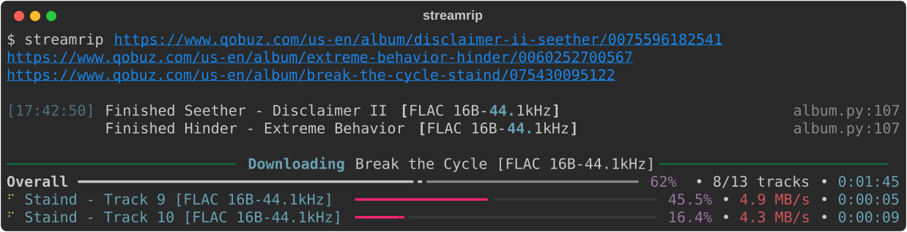
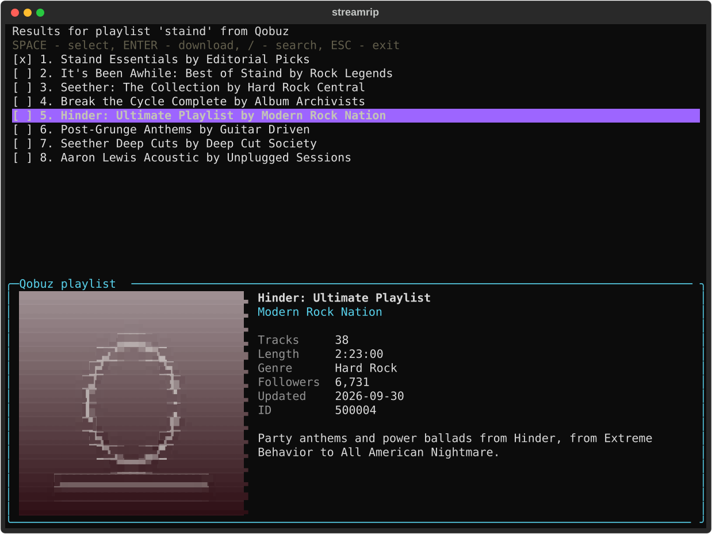

[](https://github.com/Stensel8/streamrip/actions/workflows/ci.yml)
[](https://github.com/Stensel8/streamrip/releases/latest)
[](https://github.com/Stensel8/streamrip/blob/dev/pyproject.toml)
[](https://github.com/Stensel8/streamrip/pkgs/container/streamrip)
[](https://github.com/Stensel8/streamrip/actions/workflows/container-scan.yml)

A fast, all-in-one scriptable music downloader for Qobuz, Deezer, Tidal, SoundCloud and Spotify.

> [!NOTE]
> A fork of [nathom/streamrip](https://github.com/nathom/streamrip) that I keep
> working and up to date ([changes](CHANGELOG.md)). It needs the latest stable
> Python, and streaming services change their APIs without notice, so things can
> break.

> [!IMPORTANT]
> `pip install streamrip`, the AUR package and `brew install streamrip` install
> **upstream** streamrip, which doesn't work on Python 3.15.



- Tracks, albums, playlists, discographies and labels, Spotify links
  ([details](docs/spotify.md)), CSV lists ([details](docs/csv-lists.md)) and
  last.fm playlists
- Interactive search on every source
- Tags, cover art and lyrics, and if you like conversion to FLAC, ALAC, AIFF, MP3,
  AAC, OGG or Opus
- Remembers what it downloaded; `streamrip repair` retries what failed

## Install

### With Python

Download **Source code (zip)** from the [latest release](https://github.com/Stensel8/streamrip/releases/latest),
extract it and run the installer in that folder:

```bash
./install.sh                                              # Linux, macOS
powershell -ExecutionPolicy Bypass -File .\install.ps1    # Windows
```

It installs streamrip and ffmpeg into a `.venv` there with
[uv](https://docs.astral.sh/uv/), and Python 3.15 if you don't have it. Run
`.venv/bin/streamrip` (Windows: `.venv\Scripts\streamrip.exe`), or activate the
venv and type `streamrip`.

### With Podman or Docker

Everything built in, ffmpeg too, for amd64 and arm64:

```bash
mkdir -p streamrip
podman run --rm -it -v ./streamrip:/data ghcr.io/stensel8/streamrip url <link>
```

Config, databases and downloads end up in `./streamrip`. Docker, SELinux and
more: [docs/container.md](docs/container.md).

### With Nix

```bash
nix run . -- url <link>      # x86_64 Linux, from this checkout
```

More in [docs/nix.md](docs/nix.md).

## Use

```bash
streamrip url https://tidal.com/browse/album/234793           # an album, artist, playlist or track
streamrip url <link> <link>                                     # several at once
streamrip file urls.txt                                         # the links in a file, one per line
streamrip id tidal album 234793                                 # by source, type and ID
streamrip search tidal album 'linkin park meteora'              # search, and pick
streamrip search --first tidal track 'linkin park in the end'   # search, and take the first
streamrip csv linkin-park.csv                                   # a CSV list of tracks
streamrip lastfm https://www.last.fm/user/nathan3895/playlists/12126195
streamrip --codec mp3 url <link>                                # convert while downloading
streamrip --quality 2 url <link>                                # at most CD quality
streamrip repair                                                # retry what failed
streamrip config open                                           # every option, explained
```

Links from Qobuz, Deezer, SoundCloud and Spotify work the same way, and every
command has `--help`. Each source is asked for its highest quality, stepping down
when a track doesn't have it; `--quality` sets the highest to ask for:

| Quality | Audio                                        | Sources              |
| ------- | -------------------------------------------- | -------------------- |
| 0       | 128 kbps MP3 (Deezer), 256 kbps AAC (Tidal)  | Deezer, Tidal        |
| 1       | 320 kbps MP3 or AAC                          | Deezer, Tidal, Qobuz |
| 2       | 16 bit, 44.1 kHz (CD)                        | Deezer, Tidal, Qobuz |
| 3       | 24 bit, ≤ 96 kHz (Qobuz), ≤ 192 kHz (Tidal)  | Tidal, Qobuz         |
| 4       | 24 bit, ≤ 192 kHz                            | Qobuz                |



## Logging in

streamrip asks for what it needs the first time you use a source, and saves it
in the config. A login that stops working is asked for again.

| Source | You need |
| --- | --- |
| Qobuz | A subscription, or the albums you bought. Log in with an isolated browser window, your own browser, or by hand. |
| Tidal | A subscription. Log in with a link on any device (twice, for hi-res). |
| Deezer | The `arl` cookie of a logged-in session: an isolated browser window, or by hand. |
| SoundCloud | Nothing. |
| Spotify | An app of your own, and Premium on the account that owns it. The audio comes from YouTube Music and is not lossless. |

Details per source: [Logging in](docs/logging-in.md), [Spotify](docs/spotify.md).

## More

- [Spotify](docs/spotify.md): the app you need, what works, and why it isn't lossless
- [CSV lists](docs/csv-lists.md): download a list exported from Music-Sync, Exportify or a spreadsheet
- [Lyrics](docs/lyrics.md): where they come from, and how to turn the lookup off
- [Podman and Docker](docs/container.md): the image, its volume, and building it yourself
- [Nix](docs/nix.md): the flake and its development shell

## Contributing

Report problems in the [issue tracker](https://github.com/Stensel8/streamrip/issues).
For code, `uv sync --all-extras` sets things up, and `uv run pytest` and
`uv run ruff check . && uv run ruff format .` should pass before you open a pull
request to `dev`. Tests that drive a real browser are skipped when there is none.
CI leaves the tests about logins and sessions out; [checks/](checks/README.md)
runs those, the checks with real accounts and everything else CI does, by hand.

## Acknowledgements

streamrip was written by [nathom](https://github.com/nathom) (consider
[sponsoring nathom](https://github.com/sponsors/nathom)); this fork builds on
everyone who sent fixes upstream, credited in [CHANGELOG.md](CHANGELOG.md).
Thanks to Vitiko98, Sorrow446 and DashLt for their contributions. streamrip was
inspired by [rip](https://github.com/nathom/streamrip),
[qobuz-dl](https://github.com/vitiko98/qobuz-dl),
[Qo-DL Reborn](https://github.com/badumbass/Qo-DL-Reborn),
[Tidal-Media-Downloader](https://github.com/yaronzz/Tidal-Media-Downloader)
and [scdl](https://github.com/flyingrub/scdl). The lyrics lookup uses
[LRCLIB](https://lrclib.net). The Spotify support borrows from three projects,
credited in [docs/spotify.md](docs/spotify.md#credits).

## Disclaimer

I will not be responsible for how **you** use streamrip. By using streamrip, you
agree to the terms and conditions of the Qobuz, Tidal, Deezer and Spotify APIs,
and of YouTube, which the audio of Spotify tracks comes from.
